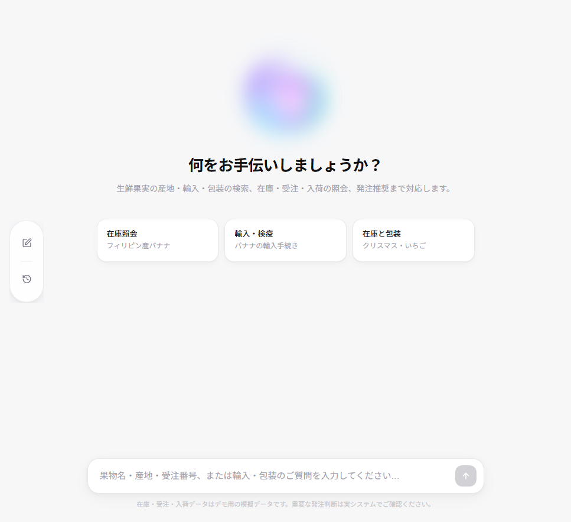
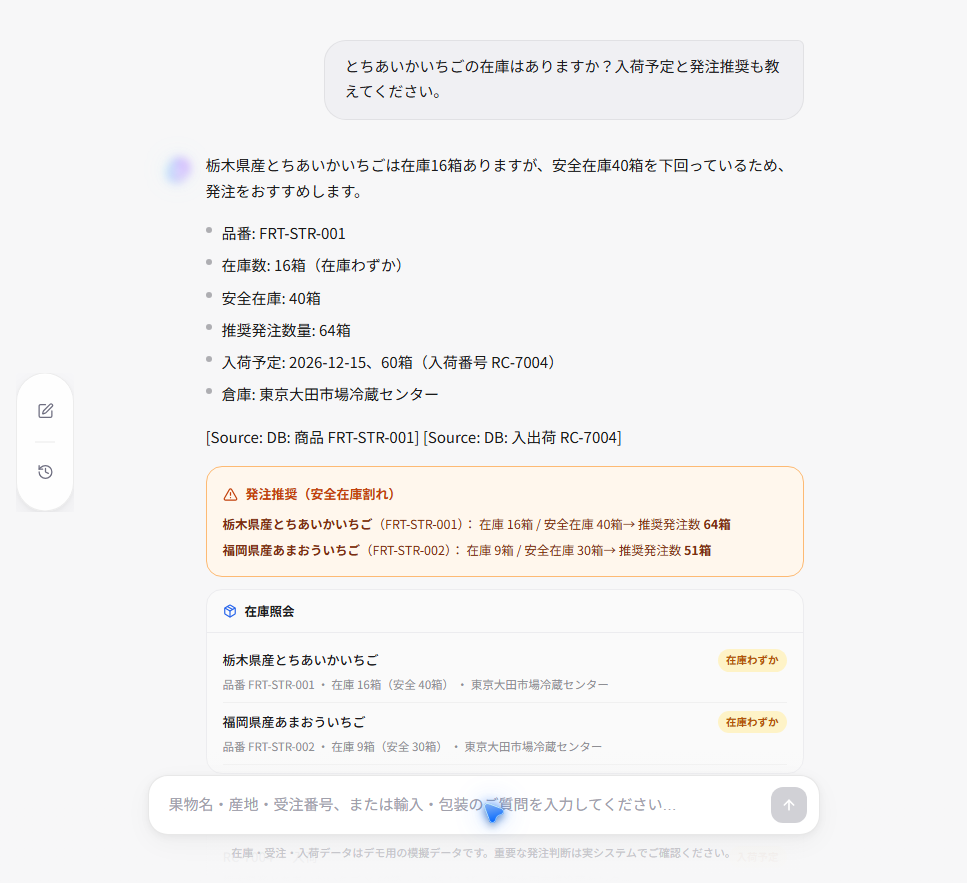
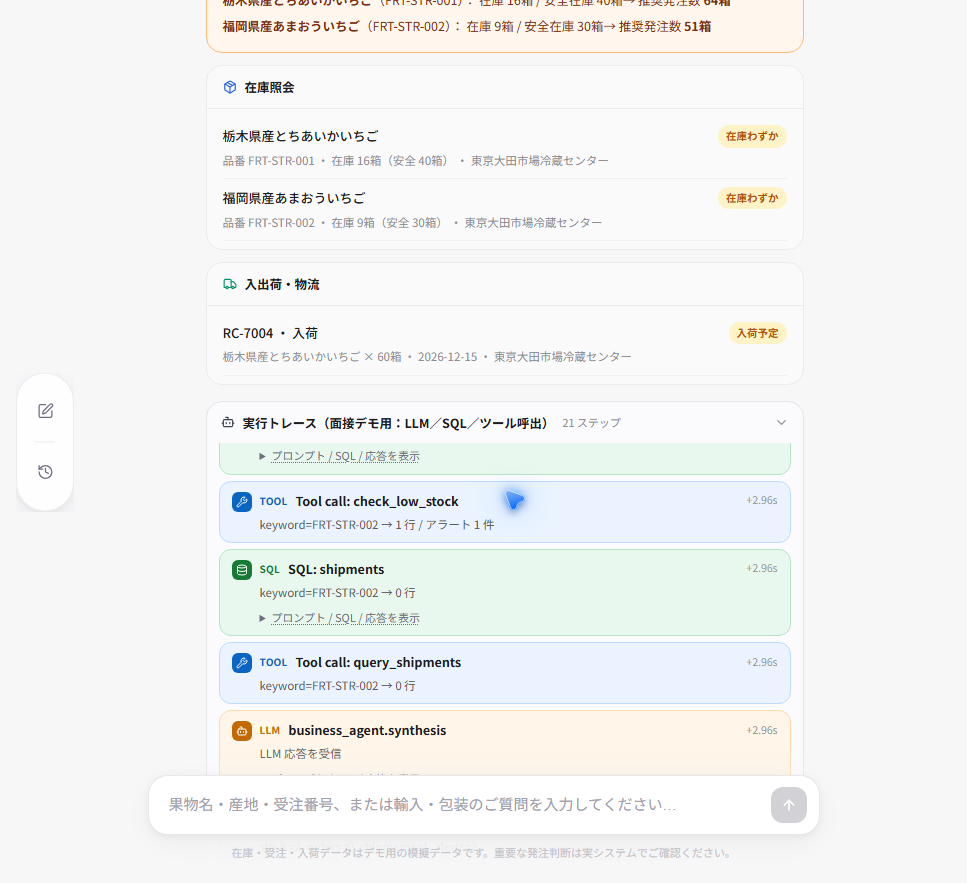
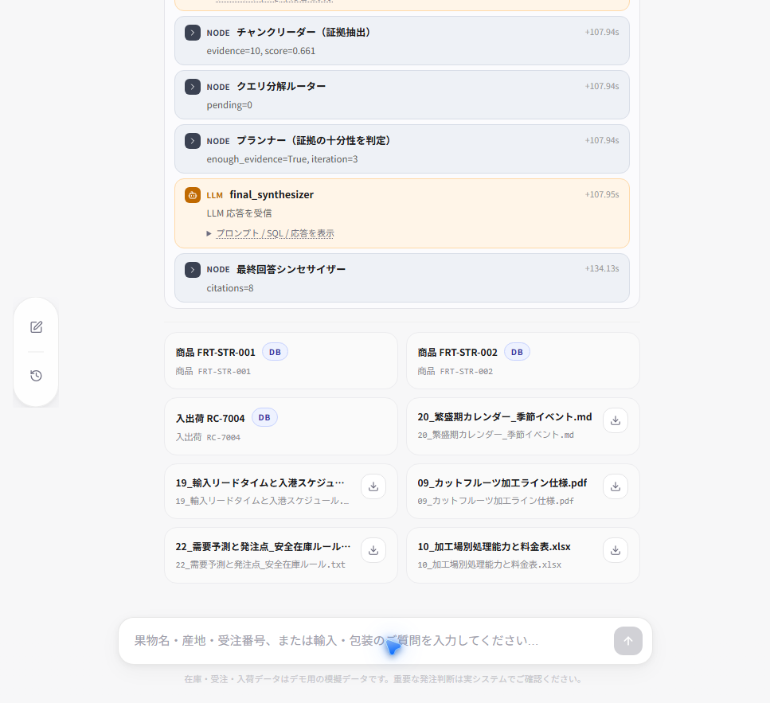
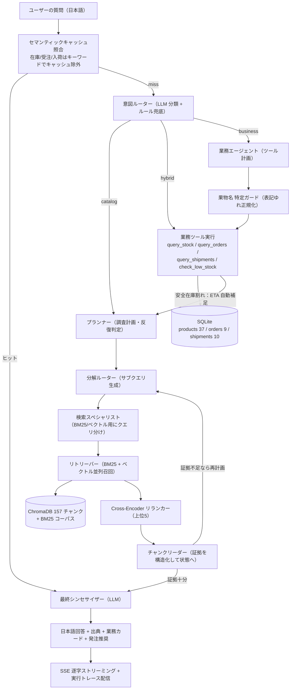

# trade_knowledge — 生鮮果実商社向け Agentic RAG 業務アシスタント

青果（フルーツ）専門商社の業務を想定した、**文書検索（RAG）と業務データ照会（ツール呼出）をひとつのエージェントで統合した日本語対応の業務アシスタント**です。産地・輸入検疫・加工・包装といった**非構造文書**の質問には Agentic RAG で根拠付き回答を、在庫・受注・入出荷といった**構造化データ**の質問には LLM が業務ツールを選択して実データを返します。


> **ポートフォリオのポイント**：単発の RAG ではなく、LangGraph で**意図分類・計画・混合検索・リランク・証拠抽出・ツール呼出・合成を明示した観測可能なエージェントループ**として実装。さらに **LLM に数値を一切生成させず、在庫数・納期は必ずデータベースを唯一の真実源とする**設計、SSE 逐字ストリーミング、LLM/SQL/ツール呼出のフルトレース表示を備えています。

---

## 目次

- [解決する課題](#解決する課題)
- [デモ画面](#デモ画面)
- [3 つのルーティング](#3-つのルーティング)
- [システムアーキテクチャ](#システムアーキテクチャ)
- [技術ハイライト](#技術ハイライト)
- [実装で直面した課題と解決](#実装で直面した課題と解決)
- [データ基盤（模擬 ERP）](#データ基盤模擬-erp)
- [ナレッジベース](#ナレッジベース)
- [技術スタック](#技術スタック)
- [ディレクトリ構成](#ディレクトリ構成)
- [クイックスタート](#クイックスタート)
- [業務 DB の確認・更新](#業務-db-の確認更新)
- [資料の差し替えとインデックス再構築](#資料の差し替えとインデックス再構築)
- [API](#api)
- [プロダクション移行に向けて](#プロダクション移行に向けて)
- [制約・今後の課題](#制約今後の課題)

---

## 解決する課題

生鮮果実商社の現場では、性質の異なる 2 種類の問いが混在します。

1. **非構造文書の問い**：「フィリピン産バナナの植物検疫手続きは？」「クリスマス用いちごの等級・選別と包装規格は？」——答えは PDF / Word / Excel / Markdown などの社内資料に散在。
2. **構造化データの問い**：「とちあいかの在庫は？」「受注 SO-1101 の状況は？」「入荷はいつ？」——答えは ERP / WMS のデータベースにあり、毎日変動し、数値を誤れない。

本システムは LLM の意図分類で両者をひとつのチャット画面に統合し、文書には RAG、業務データにはツール呼出で答え、在庫が安全在庫を下回ると**入荷予定（ETA）の自動補足と発注推奨**を提示します。すべての回答に**出典（文書ファイルまたは DB レコード）**を付与します。

## デモ画面

**① 日本語チャット画面**（Next.js）。想定質問カードから 1 クリックでデモ可能。



**② 業務データ照会（business）**：在庫カード・入出荷カード・発注推奨アラートを色分け表示。とちあいか在庫 16 箱（安全 40 箱）→ 推奨発注 64 箱、入荷 RC-7004（12/15）を自動補足。



**③ フルトレース可観測性**：「実行トレース」パネルに LLM 呼出・発行 SQL・ツール呼出を時系列で表示。プロンプト / SQL / 応答をその場で展開でき、各ステップの所要時間も分かります。



**④ 複合質問（hybrid）**：在庫・入荷という DB の事実と、包装・選別という文書の規格を 1 つの回答に合成。文書は PDF / Word / Excel / Markdown / テキストを横断して引用します。



## 3 つのルーティング

| ルート | 判定される質問 | 処理 | 出典 |
|---|---|---|---|
| **catalog** | 産地・旬・植物検疫・関税・加工・包装・表示などの**商品知識** | Agentic RAG（混合検索 → リランク → 証拠抽出 → 反復計画） | 文書ファイル |
| **business** | 在庫・受注・入出荷・安全在庫・納期などの**業務照会** | LLM がツールを選択して SQLite を照会（必要なら ETA を自動補足） | DB レコード |
| **hybrid** | 両方を含む質問（例：クリスマス用いちごの在庫と包装規格） | 業務ツールを先に実行 → RAG で文書検索 → 最終合成 | DB + 文書 |

ルーターは LLM が理由付き JSON で分類したうえで、日本語キーワードによるルールでガードします（**LLM 判定 + 決定論的フォールバック**）。

## システムアーキテクチャ



## 技術ハイライト

- **明示的な Agentic RAG ループ（LangGraph）**：意図ルーター → プランナー → クエリ分解 → 検索 → リランク → 証拠読み取り → 合成を独立ノードに分離し、共有状態（証拠メモリ）で受け渡し。プランナーは証拠が十分かを判定し、不足なら調査クエリを組み替えて最大 3 周反復します。各段階がテスト・観測可能です。
- **ハイブリッド検索 + Cross-Encoder リランク**：BM25 とベクトルを並列召回し、多言語 Cross-Encoder で再順位付けして上位 5 件を採用。果名・品種名・等級（`とちあいか`、`赤秀・2L`、`FRT-STR-001`）といった**表層一致**に BM25、「追熟管理」「検疫に必要な書類」といった**概念一致**にベクトルが強く、両者で再現率と精度を両立します。
- **日本語最適化**：多言語 Embedding / Reranker を採用し、BM25 は日本語 bigram トークナイズ（カタカナ品種名は整語保持）。さらに果物名の表記ゆれを吸収する**同義語レイヤー**を独自実装（[後述](#実装で直面した課題と解決)）。
- **数値の真実性（ハルシネーション対策）**：LLM は「どのツールを呼ぶか」「引数をどうするか」「結果をどう日本語で伝えるか」だけを担当し、**在庫数・単価・納期は SQL の結果だけを唯一の真実源**にします。果物名・品番・伝票番号は決定論的に正規化して照合し、該当なしは「見つかりません」と返して全表走査には退化しません。
- **果物名の表記ゆれ吸収**：26 組の果物同義語（ひらがな / カタカナ / 漢字 / 英語 / 品種名 / 中文）を辞書化し、平仮名→片仮名に統一。**最長一致と部分文字列カバー判定**により、「グレープ」が「グレープフルーツ」内で誤発火する問題を防止。`苺 / イチゴ / あまおう / とちあいか / STRAWBERRY / 草莓` を正しく該当品番へ収束させます。
- **マルチフォーマット文書パース**：PDF は `pypdf`、Word は `python-docx`（見出し・段落・表を文書順に読取）、Excel は `openpyxl`（複数シート・全セルを走査しシート名を文脈付与）。商社の現場では仕様が Word、価格・包装表が Excel にあるのが普通で、5 形式を横断した RAG を実現しています。
- **エージェント的な能動補足**：在庫が安全在庫を下回ると、追加指示を待たず入出荷表を照会して在途 ETA を提示。例：とちあいか 16/40（推奨 64 箱）に対し RC-7004 が 12/15 に 60 箱入荷、クリスマス納期 12/18 に間に合うかの判断を支援。
- **セマンティックキャッシュ戦略**：類似の文書質問はウォームパスで即返し（初回証拠を再利用）、業務質問はキーワードガードで確実にバイパスして常に最新値を取得。さらに**検索 0 件の空回答はキャッシュに書かない**ガードを入れ、一時的な検索失敗が後続の回答を汚染しないようにしています。
- **SSE 逐字ストリーミング + フルトレース**：最終回答は `/ask/stream` からトークン単位で配信。並行して `node / llm / sql / tool / cache / answer_delta / final` イベントを流し、UI が実行トレースを時系列表示。LLM の System Prompt・発行 SQL（表・パラメータ・行数）・ツール結果を面接でその場に提示できます。
- **閉域（Closed-domain）**：Web フォールバックを無効化し、出典は自社のナレッジと業務 DB に限定。社内品番・価格を公開 Web のノイズで汚しません。
- **出典・証跡の UI 化**：文書はファイル名バッジと原文ダウンロード（`/source/download`）、DB は品番・伝票に `DB` タグを付与。`business_result` を構造化 JSON で返し、在庫・入出荷・発注推奨をカード描画します。

## 実装で直面した課題と解決

### 1. 日本語クエリが検索されず空転した（プランナー正規化のバグ）

果物へ切り替えた直後、業務ルートは正常だが文書ルートが「該当なし」を返す事象が発生しました。

1. **現象把握**：`citations=0`、証拠スコア 0。
2. **ログ切り分け**：トレースで意図ルーターは catalog 正判定する一方、プランナーが 3 周連続 `planned=[]` で**検索ノード自体が未実行**と判明。
3. **変数の切り分け**：プランナーの LLM 呼び出しを単独で再現し、モデルは正常な日本語サブクエリと妥当な JSON を返していることを確認（モデル起因を除外）。
4. **根本原因**：プランナーの正規化が `re.sub(r"[^a-z0-9]+", " ", text.lower())` でラテン文字・数字だけを残し、**仮名・漢字がすべて空白になった**結果、純日本語クエリが空文字列となり、重複除去ロジックで「冗長」として破棄されていた。旧（金属部品）版は `6204ZZ / SUS304` といった英数字品番が含まれたため偶然回避されていました。
5. **修正**：正規化で仮名・漢字領域を保持。併せて「証拠ゼロかつ計画が空」の場合は元クエリで再検索する決定論フォールバックを追加。修正後、catalog の証拠スコアは約 0.84 に回復。

> 言語・ドメインを変えて初めて顕在化する前処理バグであり、トレースログと最小再現による切り分けが重要だという学びでした。

### 2. 検索失敗の空結果がセマンティックキャッシュに定着した

上記の空転中に「該当なし」回答がキャッシュへ書かれ、後続の類似質問まで空結果を返す状態になりました。`citations` も `business_result` も無い回答はキャッシュに保存しないガード、およびヒット時に `route` / `business_result` をメタデータから復元する処理を追加して解消しています。

## データ基盤（模擬 ERP）

ERP / WMS をインストールせず再現できるよう、業務データは **SQLite ファイル DB**（コンテナ内 `/app/data/business.db`、起動時に自動建表・seed）に同梱しています。

| テーブル | 主なカラム | 件数 |
|---|---|---|
| `products` | product_code, name, category, spec, unit, price_jpy, stock_qty, safety_stock, warehouse | **37**（6 カテゴリ） |
| `orders` | order_no, customer, product_code, qty, status, order_date, due_date | **9**（イオン・業務スーパー・コープなど） |
| `shipments` | shipment_no, product_code, direction（入荷/出荷）, qty, status, date_or_eta, warehouse | **10** |

- **品番**：`FRT-`、**受注**：`SO-2026-XXXX`、**入荷**：`RC-700X`、**出荷**：`SH-900X`。
- **低在庫 10 品・在庫切れ 2 品**（玉荷包ライチ、佐藤錦さくらんぼ）を意図的に埋め込み。
- **発注推奨数 = 安全在庫 × 2 − 在庫**。とちあいか 40×2−16 = 64、あまおう 30×2−9 = 51。
- 冷蔵倉庫：横浜本牧冷蔵倉庫 / 成田空港冷蔵物流センター / 東京大田市場冷蔵センター。

## ナレッジベース

`api/data_docs/` に**26 ファイル・5 形式**（PDF 7 / Word 5 / Excel 4 / Markdown 7 / テキスト 3）の日本語資料を配置。起動時に 300 トークン・40 オーバーラップでチャンク化し、**157 チャンク**が BM25 / ChromaDB へインデックスされます。

主なテーマ：産地・旬カレンダー、品種と産地マップ、植物検疫・輸入検査、食品衛生法の届出、関税・HS コード、検疫有害動植物・条件付き解禁、提携加工場、カットフルーツ加工ライン、加工能力・料金、等級・階級・選別、包装資材・段ボール規格、食品表示ラベル、小売チャネル別納品基準、納品先マスタ、コールドチェーン SOP、協力物流・運賃、リードタイム・入港スケジュール、繁盛期カレンダー、緊急・特急発注 SOP、需要予測・安全在庫ルール、クレーム対応、トレーサビリティ、用語集。

## 技術スタック

| 層 | 構成 |
|---|---|
| オーケストレーション | LangGraph、langchain-core |
| 生成 LLM | OpenAI 互換クライアント（DeepSeek 等、`.env` で差し替え可能） |
| Embedding | `paraphrase-multilingual-MiniLM-L12-v2`（ローカル・384 次元） |
| Reranker | `cross-encoder/mmarco-mMiniLMv2-L12-H384-v1`（ローカル） |
| ベクトル DB | ChromaDB（ローカル） |
| キーワード検索 | rank-bm25（日本語 bigram） |
| 文書パース | pypdf / python-docx / openpyxl |
| バックエンド | FastAPI、Uvicorn、slowapi（レート制限）、Pydantic |
| 業務 DB | SQLite（標準ライブラリ） |
| フロントエンド | Next.js 16、React 19、TypeScript、Tailwind CSS、framer-motion、lucide-react |
| 実行基盤 | Docker Compose（api / web 2 コンテナ + データ・モデルキャッシュ領域） |

Embedding / Reranker はローカルモデルのため API 費用は生成 LLM のみです。

## ディレクトリ構成

```text
trade_knowledge/
├── docker-compose.yml          # api / web / ボリューム定義
├── db.ps1 / db.py              # 業務 DB を照会・更新するヘルパー（コンテナ内 SQLite を操作）
├── docs/                       # README 用デモ画像
├── api/                        # FastAPI + LangGraph バックエンド
│   ├── api/main.py             # /ask, /ask/stream, /health, /source/download
│   ├── app/
│   │   ├── graph/builder.py    # LangGraph ノード・エッジ・キャッシュ分岐
│   │   ├── nodes/              # intent_router / planner / business_agent /
│   │   │                       # decomposition_router / retrieval_specialist /
│   │   │                       # retriever / reranker / chunk_reader / final_synthesizer
│   │   ├── retrievers/         # BM25 / ベクトル / リランカー
│   │   ├── tools/              # business_tools.py（果物ガード・業務ツール）, database.py（SQLite seed）
│   │   ├── state/schema.py     # グラフ共有状態（証拠メモリ）
│   │   └── utils/              # llm / logger / semantic_cache / tokenizer / events ...
│   ├── data_docs/              # 26 ファイルの日本語資料（5 形式、再帰取込）
│   ├── ingestion/              # parser（pdf/docx/xlsx/md/txt）・チャンク・インデックス
│   ├── eval/                   # 評価・ベンチマーク
│   └── tests/                  # グラフ構造・ノードのテスト
└── web/                        # Next.js 16 フロントエンド
    └── src/
        ├── app/                # チャット画面
        ├── components/         # ChatPanel / Sidebar / HistoryPanel / 業務カード / 実行トレース ...
        └── context/            # ChatContext（会話状態・localStorage 永続化）
```

## クイックスタート

**前提**：Docker Desktop が動作していること。

```bash
# 1. API キー設定（リポジトリには同梱されていません）
cp api/.env.example api/.env
#   api/.env を編集して OPENAI_BASE_URL / OPENAI_API_KEY / LLM_MODEL を設定

# 2. 全スタック起動（初回はモデルDLと索引構築で数分）
docker compose up -d --build
```

- **Web（チャット画面）**：http://localhost:3000
- **API（Swagger UI）**：http://localhost:8000/docs
- ヘルスチェック：http://localhost:8000/health

`.env` の主な設定（`api/.env.example` 参照）：

```text
LLM_PROVIDER=openai
OPENAI_BASE_URL=https://api.example.com/v1
OPENAI_API_KEY=your-key
LLM_MODEL=your-model
RESPONSE_LANGUAGE=japanese
EMBEDDING_MODEL=paraphrase-multilingual-MiniLM-L12-v2
RERANKER_MODEL=cross-encoder/mmarco-mMiniLMv2-L12-H384-v1
MAX_ITERATIONS=3
TOP_K_RETRIEVAL=10
TOP_K_RERANK=5
WEB_FALLBACK_ENABLED=false
RATE_LIMIT=10/minute
```

> API キーを含む `api/.env` は `.gitignore` で除外しています（リポジトリにコミットされません）。

## 業務 DB の確認・更新

プロジェクト直下の `db.ps1` がコンテナ内 SQLite を操作します。

```powershell
.\db.ps1 summary                                   # 3 表の行数 + 低在庫一覧
.\db.ps1 products                                  # 全商品
.\db.ps1 low                                       # 安全在庫割れ
.\db.ps1 sql "SELECT * FROM products WHERE stock_qty <= safety_stock"   # 読取
.\db.ps1 write "UPDATE products SET stock_qty=20 WHERE product_code='FRT-STR-001'"  # 書込
.\db.ps1 refresh                                   # 読取専用コピーを出力（VSCode SQLite Viewer 用）
```

> 実行ポリシーで拒否される場合は `powershell -ExecutionPolicy Bypass -File .\db.ps1 summary`。

## 資料の差し替えとインデックス再構築

自社資料を `api/data_docs/` へ置く（サブフォルダ可）だけで取り込めます。索引を作り直す場合はデータ領域を破棄して再起動します。

```bash
docker compose down
docker volume rm trade_knowledge_backend_data   # 索引・業務DBを初期化
docker compose up -d --build
```

> モデルキャッシュ領域（`trade_knowledge_hf_cache`）は残るため、2 回目以降はモデル再 DL が不要です。
> スキャン画像の PDF はテキストを含まないため、別途 OCR が必要です。

## API

| メソッド / パス | 内容 |
|---|---|
| `GET /health` | ヘルスチェック |
| `POST /ask` | 通常応答：`{ answer, citations, evidence_score, from_cache, route, business_result }` |
| `POST /ask/stream` | SSE ストリーミング：`status / cache / node / llm / sql / tool / answer_delta / final / error` |
| `GET /source/download?path=...` | 文書原文（PDF / Word / Excel / Markdown / テキスト）をダウンロード |

リクエスト例：

```bash
curl -X POST http://localhost:8000/ask \
  -H "Content-Type: application/json" \
  -d '{"query":"とちあいかの在庫と入荷予定を教えてください"}'
```

評価・テスト：

```bash
docker compose exec api python -m pytest      # ノード・グラフ構造のテスト
docker compose exec api python eval/run_eval.py
```

## プロダクション移行に向けて

- 業務ツールを SQLite から **SAP / 在庫システム / WMS の API または MCP 接続**へ置換（ツールシグネチャは不変）。
- 読取専用権限・タイムアウト・サーキットブレーカー・監査ログ、ユーザー権限に応じたデータフィルタリングを追加。
- 在庫系はキャッシュを恒久バイパス、または短 TTL 化。
- 書込操作（発注・在庫移動）は人間の承認ステップを挟む。
- 文書は増分インジェスト・バージョン管理、ローカルの埋込/リランカーはマネージドサービスへの置換を想定。

## 制約・今後の課題

- 認証・マルチテナントは未実装（デモ用途）。
- 業務データは模擬データ。発注判断は実システムでの確認が必要。
- 会話履歴はブラウザの localStorage 保存。バックエンド側のマルチターン文脈（セッションをまたぐ品番の暗黙継承）は今後の課題。
- スキャン PDF の OCR、合併セルを含む複雑 Excel の構造化は未対応。
- 冷経路は複数回 LLM を呼ぶため遅延が大きく（hybrid で数十秒）、SSE で体感を緩和。並列検索・小モデル分流が最適化候補。

## 作者

**Zhiyuan Sun** — GitHub: [ZhiyuanLabs](https://github.com/ZhiyuanLabs)

## ライセンス

[Apache License 2.0](./LICENSE)
