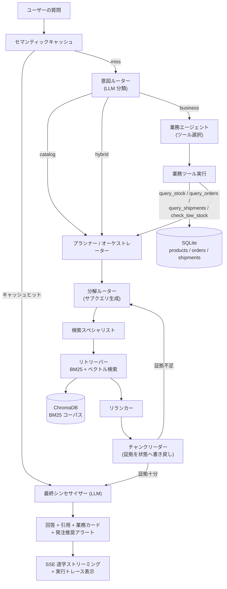

# trade_knowledge

日本総合商社向けの **Agentic RAG 業務アシスタント**です。商品カタログへの文書検索（RAG）と、在庫・受注・入出荷といった業務データの照会を、ひとつのエージェントで統合したポートフォリオプロジェクトです。


## プロジェクト概要

商社の業務現場では、「この配管の仕様は？」という**商品カタログの質問**と、「在庫は何本ある？ 受注はいつ入る？」という**業務データの質問**が混在します。本システムは、LLM の意図分類（ルーティング）によって両者をひとつの対話インターフェースで扱います。

- **カタログ質問（catalog）**：商品カタログ文書をハイブリッド検索（BM25 + ベクトル）し、リランカーと証拠メモリを経て根拠付きで回答
- **業務質問（business）**：SQLite の模擬業務データベースをツールとして呼び出し、在庫・受注・入出荷を照会
- **複合質問（hybrid）**：カタログと業務データの両方を参照して回答（例：在庫切れ商品の代替品をカタログから探す）

オーケストレーションを単一のブラックボックス呼び出しに隠さず、**意図ルーティング・検索・ツール呼出・証拠収集・合成の各段階を明示した、観測可能なエージェントループ**として実装しています。

## デモで確認できること

1. ユーザーが製品の在庫・受注・入荷状況を質問する
2. エージェントが質問を分類し、参照すべき資料または呼び出す業務ツールを判断する
3. システムが模擬データベースの在庫・受注・物流を照会する
4. LLM が結果を総合し、回答とその**証拠（出典）**を提示する
5. 在庫が安全在庫を下回る場合、**発注推奨アラート**を自動表示する

## アーキテクチャ



## 主な機能

- **ハイブリッド検索**：BM25（キーワード一致）とベクトル検索（意味検索）を併用し、リランカーで再順位付け
- **明示的なエージェントループ**：LangGraph で意図ルーター / プランナー / 分解 / 検索 / リランク / 証拠読み取り / 合成を分離
- **ツール呼出（Function Calling）**：在庫・受注・入出荷・安全在庫の各ツールを LLM が選択して実行。数値は必ず DB を唯一の真実源とする
- **日本語業務ロジック**：型番・呼び径（15A/20A など）のエイリアス展開、全角半角・「×」「−」の正規化、受注番号の部分一致（例：SO-1042）に対応
- **安全在庫アラート**：`stock_qty <= safety_stock` を検知し、入荷予定（ETA）を加味した推奨発注数を算出
- **SSE ストリーミング**：`/ask/stream` が回答を逐字で返すと同時に、LLM 呼出・SQL・ツール呼出の実行トレースを配信
- **可観測性（observability）**：構造化ログと、UI 上の「実行トレース」パネルで各ノードの入出力・所要時間を確認
- **出典表示**：回答に引用（カタログパス、DB レコード）を付与。カタログ原文は `/source/download` でダウンロード可能
- **会話履歴**：ブラウザの localStorage にセッションを保存し、過去の対話を開いて継続可能（デモ用）
- **ローカル実行の検索モデル**：Embedding とリランクはローカルモデル、生成 LLM は OpenAI 互換 API で差し替え可能

## ディレクトリ構成

```text
trade_knowledge/
├── docker-compose.yml          # api / web の Compose 定義
├── db.ps1 / db.py              # SQLite 業務 DB を照会・更新するヘルパー（デモ用）
├── api/                        # FastAPI + LangGraph バックエンド
│   ├── api/main.py             # FastAPI 入口（/ask, /ask/stream, /health, /source/download）
│   ├── app/
│   │   ├── graph/builder.py    # LangGraph のノード・エッジ定義
│   │   ├── nodes/              # intent_router / planner / business_agent / retriever ...
│   │   ├── retrievers/         # BM25 / ベクトル / リランカー
│   │   ├── tools/              # business_tools.py（業務ツール）, database.py（SQLite）
│   │   ├── state/schema.py     # グラフ共有状態（証拠メモリ）
│   │   └── utils/              # LLM クライアント / ロガー / セマンティックキャッシュ ...
│   ├── data_docs/              # 商品カタログ文書（.md / .pdf / .txt を再帰的に取り込み）
│   ├── ingestion/              # チャンク分割・インデックス構築
│   ├── eval/                   # 評価・ベンチマーク
│   └── tests/                  # グラフ構造・ノードのテスト
└── web/                        # Next.js 16 フロントエンド
    └── src/
        ├── app/                # チャット画面（page.tsx, layout.tsx）
        ├── components/         # ChatPanel / 業務カード / 実行トレース / 履歴パネル ...
        └── context/            # ChatContext（会話状態・localStorage 永続化）
```

## 模擬業務データベース（SQLite）

業務データは、外部 ERP/WMS をインストール不要で再現できるよう、**SQLite のファイル DB**（コンテナ内 `/app/data/business.db`）として同梱しています。

| テーブル | 主なカラム | 内容 |
|---|---|---|
| `products` | product_code, name, category, spec, stock_qty, safety_stock, unit, warehouse | 商品マスタ・在庫 |
| `orders` | order_no, customer, product_code, qty, status, order_date, due_date | 受注 |
| `shipments` | shipment_no, product_code, direction, qty, status, date_or_eta, warehouse | 出荷・入荷（物流） |

照会・更新はプロジェクト直下のヘルパーから行えます（PowerShell）。

```powershell
./db.ps1 summary      # 概要
./db.ps1 tables       # テーブル一覧
./db.ps1 products     # 商品
./db.ps1 low          # 安全在庫割れ商品
./db.ps1 sql "SELECT * FROM products WHERE stock_qty <= safety_stock"
```

## 商品カタログ文書の差し替え

自社の商品カタログ（PDF / Markdown / TXT）を `api/data_docs/` 配下に置くだけで、起動時のインジェストが再帰的にチャンク分割・インデックス化します。

1. 資料を `api/data_docs/` に配置（サブフォルダ可）
2. 既存のインデックスを破棄して再構築

```bash
docker compose down
docker volume rm trade_knowledge_backend_data
docker compose up --build
```

> スキャンした画像 PDF はテキストを含まないため、別途 OCR が必要です。

## 起動方法

Docker Compose で全スタックを起動します。

```bash
docker compose up --build
```

- API（FastAPI）: http://localhost:8000 （Swagger UI: `/docs`）
- Web（Next.js）: http://localhost:3000

初回起動時のみ、カタログのインデックス構築とローカル検索モデルのダウンロードで時間がかかります。

### 生成 LLM の設定

`api/.env`（`api/.env.example` をコピー）に OpenAI 互換のエンドポイントを設定します。

```text
LLM_PROVIDER=openai
OPENAI_BASE_URL=https://api.example.com/v1
OPENAI_API_KEY=sk-...
LLM_MODEL=your-model
RESPONSE_LANGUAGE=japanese
```

Embedding とリランクはローカルモデルで動作するため、API 費用は生成 LLM のみです。

## 技術スタック

- **オーケストレーション**: LangGraph / langchain-core
- **生成 LLM**: OpenAI 互換クライアント（プロバイダ差し替え可能）
- **埋め込み**: sentence-transformers（ローカル）
- **ベクトル DB**: ChromaDB（ローカル）
- **キーワード検索**: rank-bm25
- **バックエンド**: FastAPI, Uvicorn, slowapi（レート制限）
- **業務 DB**: SQLite（標準ライブラリ）
- **フロントエンド**: Next.js 16, React 19, Tailwind CSS, framer-motion, lucide-react
- **実行基盤**: Docker Compose

## 実装のポイント

- LLM に数値を計算させず、**在庫数・受注・物流は必ず DB ツールの結果を唯一の真実源**としている（ハルシネーション抑制）
- ルーティング・検索・ツール呼出を独立ノードに分け、**状態（証拠メモリ）を介して明示的に受け渡し**することで、各段階をテスト・観測可能にしている
- セマンティックキャッシュをグラフ実行前に挟み、類似質問のウォームパスを短縮
- 日本語の型番表記ゆれ（全角/半角、記号、呼び径）を正規化して、業務キーワードの照合精度を確保
- SSE で処理イベントを逐次配信し、LLM のプロンプト・発行 SQL・ツール結果をその場で確認できる

## 現在の制約

- 認証・マルチテナントは未実装（デモ用途）
- 業務データは模擬データ。実データ発注判断は実システムでの確認が必要
- 会話履歴はフロントエンドの localStorage であり、バックエンド側のマルチターン文脈（同一セッションでの型番の暗黙継承）は今後の課題
- ローカル再現性を優先し、常設ホスティングは想定していない

## 作者

**Zhiyuan Sun**

- GitHub: [ZhiyuanLabs](https://github.com/ZhiyuanLabs)

## ライセンス

[Apache License 2.0](./LICENSE)
